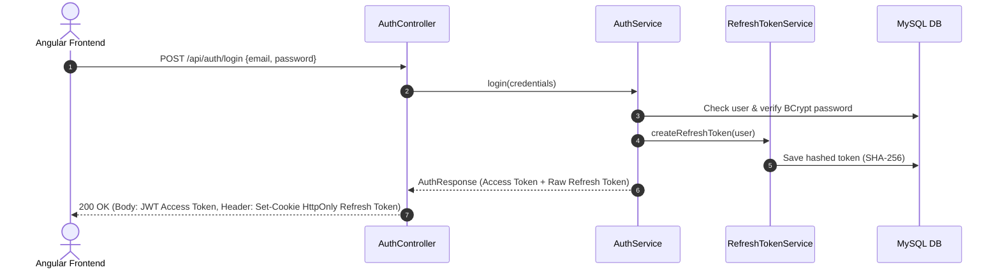

# 🌍 TripPocket — Backend REST API


TripPocket Backend is a modern, secure, and production-ready RESTful API powering the TripPocket travel planning and booking platform. Built with **Spring Boot 4.1** and **Java 17**, it manages trips, itineraries, activities, reservations, travel budgets/expenses, and features conversational AI with **Google Gemini 3.8 Flash** and itinerary generation with **Groq AI**.

---

## 📑 Table of Contents

- [Key Features](#-key-features)
- [Technology Stack](#-technology-stack)
- [Architecture & Project Structure](#-architecture--project-structure)
- [Prerequisites](#-prerequisites)
- [Configuration & Environment Variables](#-configuration--environment-variables)
- [Installation & Running](#-installation--running)
- [API Documentation & Swagger](#-api-documentation--swagger)
- [Main REST Endpoints](#-main-rest-endpoints)
- [Running Automated Tests](#-running-automated-tests)
- [Security & Authentication Flow](#-security--authentication-flow)

---

## 🚀 Key Features

* **Authentication & Authorization**:
  * Stateless JWT authentication with short-lived access tokens (15 minutes).
  * Cryptographically hashed refresh tokens (SHA-256) stored in DB with automatic replay attack detection and session revocation.
  * Google OAuth2 SSO authentication via `GoogleIdTokenVerifier`.
  * Secure password reset with expiring, single-use SHA-256 tokens and HTML emails via SMTP.
  * Role-Based Access Control (`ROLE_ADMIN`, `ROLE_TRAVELER`).
* **Trip & Itinerary Management**:
  * Full CRUD for travel offers (destinations, dates, prices, group size, highlights).
  * Day-by-day structured itinerary planning (`ItineraryDay`).
  * Binary cover image management (`LONGBLOB`).
* **Activities Catalog**:
  * Categorized activities (`SIGHTSEEING`, `RESTAURANT`, `TRANSPORT`, `LEISURE`) associated with trips.
* **Booking & Reservation Engine**:
  * Unified reservation workflow (`TRIP`, `ACTIVITY`, `HOTEL`, `FLIGHT`, etc.).
  * Status lifecycle management (`PENDING`, `CONFIRMED`, `CANCELLED`, `COMPLETED`).
* **Budget & Expense Tracking (Expense Module)**:
  * Trip-based expense recording with categories (`FOOD`, `ACCOMMODATION`, `TRANSPORT`, `ACTIVITIES`, `OTHER`).
  * Spending budgets per trip (`TripSpendingBudget`), real-time budget usage computation, and over-budget warnings.
* **AI Integrations**:
  * **TripPocket AI Travel Assistant**: Conversational frontoffice chatbot powered by **Google Gemini 3.8 Flash** via REST API (`x-goog-api-key`).
  * **Itinerary & Tagline Generator**: Backoffice assistance powered by **Groq API** (`openai/gpt-oss-120b`).

---

## 🛠 Technology Stack

* **Language**: Java 17
* **Framework**: Spring Boot 4.1.1
  * `spring-boot-starter-webmvc`
  * `spring-boot-starter-data-jpa`
  * `spring-boot-starter-security`
  * `spring-boot-starter-validation`
  * `spring-boot-starter-mail`
  * `spring-boot-starter-actuator`
* **Persistence & ORM**: Hibernate ORM 7.x, MySQL Connector/J
* **Security & Tokens**: JJWT 0.12.6, Google API Client (Google OAuth2 Token Verification)
* **API Documentation**: SpringDoc OpenAPI UI 2.8.9 (Swagger 3)
* **Build & Testing**: Maven Wrapper, JUnit 5, Mockito

---

## 📂 Architecture & Project Structure

```text
tripPocket-backend/
├── pom.xml
├── mvnw / mvnw.cmd
└── src/
    ├── main/
    │   ├── java/tn/esprit/trippocketbackend/
    │   │   ├── config/             # SecurityConfig, OpenApiConfig, ChatbotUserConfig
    │   │   ├── controller/         # REST Controllers (Auth, Trips, Expenses, Chatbot, etc.)
    │   │   ├── dto/                # Request & Response Records / DTOs
    │   │   ├── entities/           # JPA Entities (User, Trip, Reservation, BudgetExpense, etc.)
    │   │   ├── exception/          # Global Exception Handlers
    │   │   ├── repositories/       # Spring Data JPA Repositories
    │   │   ├── security/           # JwtUtil, JwtFilter, GoogleTokenVerifier, UserDetails
    │   │   └── services/           # Business Logic & Service Interfaces
    │   └── resources/
    │       └── application.properties
    └── test/
        └── java/tn/esprit/trippocketbackend/
            ├── config/             # Unit tests for Config classes
            ├── controller/         # Unit tests for REST Controllers
            ├── security/           # Unit tests for JWT & Security filters
            └── services/           # Unit tests for business services
```

---

## 📋 Prerequisites

Before running the backend, make sure you have installed:

* **Java Development Kit (JDK) 17** or higher:
  ```powershell
  java -version
  ```
* **MySQL Server 8.x**:
  * Running locally on port `3306`
  * Default database name: `tripPocketBackend`

---

## ⚙️ Configuration & Environment Variables

All settings are configured in [src/main/resources/application.properties](file:///d:/TripPocket/tripPocket-backend/src/main/resources/application.properties) with support for environment variables:

| Property | Default Value | Description |
| :--- | :--- | :--- |
| `server.port` | `8089` | Backend server port |
| `server.servlet.context-path` | `/tripPocketBackend` | Application base context path |
| `spring.datasource.url` | `jdbc:mysql://localhost:3306/tripPocketBackend?createDatabaseIfNotExist=true` | MySQL JDBC connection URL |
| `spring.datasource.username` | `root` | Database username |
| `spring.datasource.password` | *(empty)* | Database password |
| `JWT_SECRET` | *Dev fallback secret* | Secret key for signing HMAC-SHA256 JWTs |
| `MAIL_USERNAME` | `mohamedemine.larbi@gmail.com` | SMTP email for password reset links |
| `MAIL_PASSWORD` | *(app password)* | SMTP application password |
| `GEMINI_API_KEY` | *(AQ.... format)* | Google AI Studio key for Gemini 3.8 Flash |
| `gemini.api.model` | `gemini-3.8-flash` | Gemini model name |
| `app.ai.api-key` | *(gsk_...)* | Groq API key for AI itineraries & taglines |
| `app.google.client-id` | *(Client ID)* | Google OAuth2 Client ID |

---

## 🏃 Installation & Running

1. **Navigate to the backend directory**:
   ```powershell
   cd tripPocket-backend
   ```

2. **Verify / Start MySQL service**:
   Ensure MySQL is running on port 3306 (`tripPocketBackend` database will be created automatically if it doesn't exist).

3. **Build and Run the application**:
   Using the included Maven wrapper:
   ```powershell
   ./mvnw.cmd spring-boot:run
   ```
   *(On Linux/macOS, use `./mvnw spring-boot:run`)*

4. **Verify the server is up**:
   The backend will start on `http://localhost:8089/tripPocketBackend`.
   Health check endpoint:
   ```text
   GET http://localhost:8089/tripPocketBackend/actuator/health
   ```

---

## 📖 API Documentation & Swagger

TripPocket provides an interactive OpenAPI 3 (Swagger UI) dashboard:

* **Swagger UI**: [http://localhost:8089/tripPocketBackend/swagger-ui/index.html](http://localhost:8089/tripPocketBackend/swagger-ui/index.html)
* **OpenAPI JSON Spec**: `http://localhost:8089/tripPocketBackend/v3/api-docs`

To execute authenticated requests in Swagger, click the **Authorize** button and supply a valid Bearer JWT:
```text
Bearer <your_access_token>
```

---

## 📡 Main REST Endpoints

### 🔐 Authentication (`/api/auth`)
* `POST /api/auth/register` — Register a new traveler account.
* `POST /api/auth/login` — Authenticate with email/password (returns JWT + sets HttpOnly refresh cookie).
* `POST /api/auth/google` — Sign in / Register with Google OAuth2 credential.
* `POST /api/auth/refresh` — Rotate refresh token and obtain a fresh JWT access token.
* `POST /api/auth/logout` — Revoke active refresh session and clear cookie.
* `POST /api/auth/forgot-password` — Request password reset link by email.
* `POST /api/auth/reset-password` — Set a new password using a reset token.

### 🧳 Trips (`/api/trips`)
* `GET /api/trips` — List all published trips (Public).
* `GET /api/trips/{id}` — Get trip details with itinerary and activities (Public).
* `POST /api/trips` — Create a new trip (Admin).
* `PUT /api/trips/{id}` — Update trip details (Admin).
* `DELETE /api/trips/{id}` — Remove a trip (Admin).
* `POST /api/trips/{id}/cover` — Upload trip cover image (Admin).

### 🎯 Activities (`/api/activities`)
* `GET /api/activities` — List all activities.
* `GET /api/activities/trip/{tripId}` — List activities for a specific trip.
* `POST /api/activities` — Add activity (Admin).

### 📅 Reservations (`/api/reservations`)
* `POST /api/reservations` — Book a trip or activity.
* `GET /api/reservations/my` — Get authenticated traveler's reservations.
* `GET /api/reservations` — Get all reservations (Admin).
* `PATCH /api/reservations/{id}/status` — Update reservation status (`CONFIRMED`, `CANCELLED`).

### 💰 Budget & Expenses (`/api/expenses`)
* `GET /api/expenses` — Get all expenses.
* `GET /api/expenses/trip/{tripId}` — Get all expenses for a trip.
* `POST /api/expenses?tripId={tripId}` — Record a new trip expense.
* `DELETE /api/expenses/{id}` — Delete an expense.
* `GET /api/expenses/trip/{tripId}/insights` — Retrieve total spending, category breakdown, budget usage, and AI insights.
* `PUT /api/expenses/trip/{tripId}/budget` — Set spending budget target for a trip.

### 🤖 AI Assistants
* `POST /api/chatbot-user/chat` — Contextual travel chatbot conversation via **Google Gemini 3.8 Flash**.
* `POST /api/ai/trips/{tripId}/generate-itinerary` — Auto-generate day-by-day itinerary via **Groq AI**.
* `POST /api/ai/trips/{tripId}/generate-tagline` — Auto-generate marketing tagline via **Groq AI**.

---

## 🧪 Running Automated Tests

The backend includes a comprehensive unit test suite (**72 tests**, 100% passing) covering services, controllers, security, and configuration components:

```powershell
./mvnw.cmd test
```

To run a specific test suite:
```powershell
./mvnw.cmd test "-Dtest=AuthServiceTest,UserServiceTest,BudgetExpenseControllerTest"
```

---

## 🔒 Security & Authentication Flow


